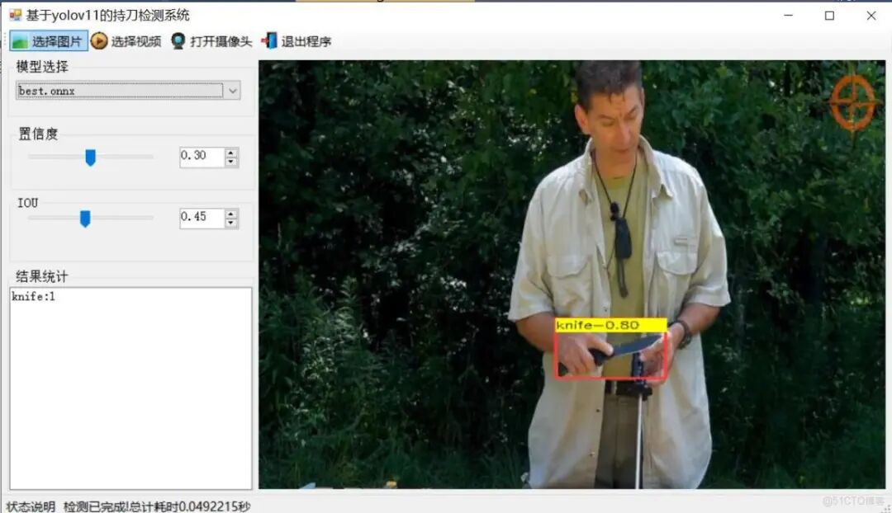
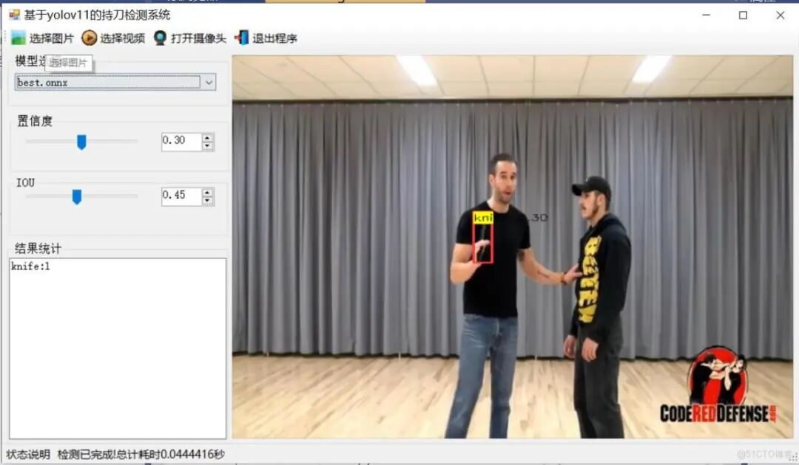
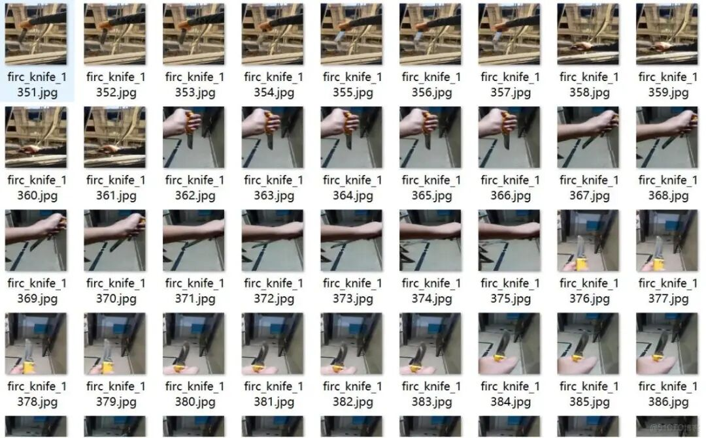
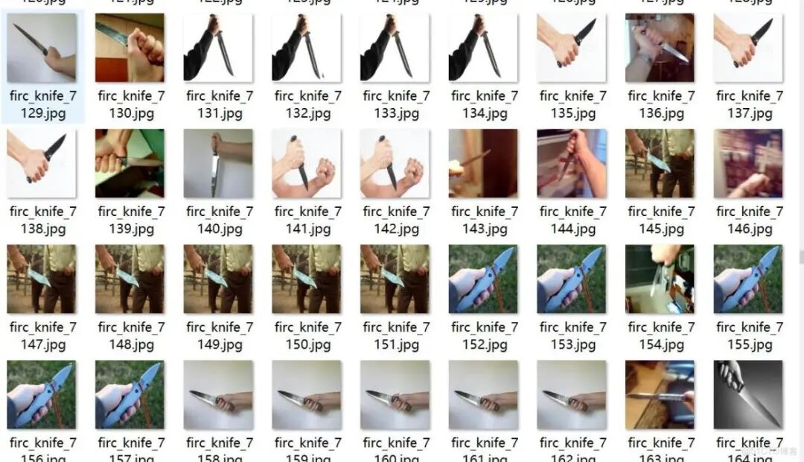
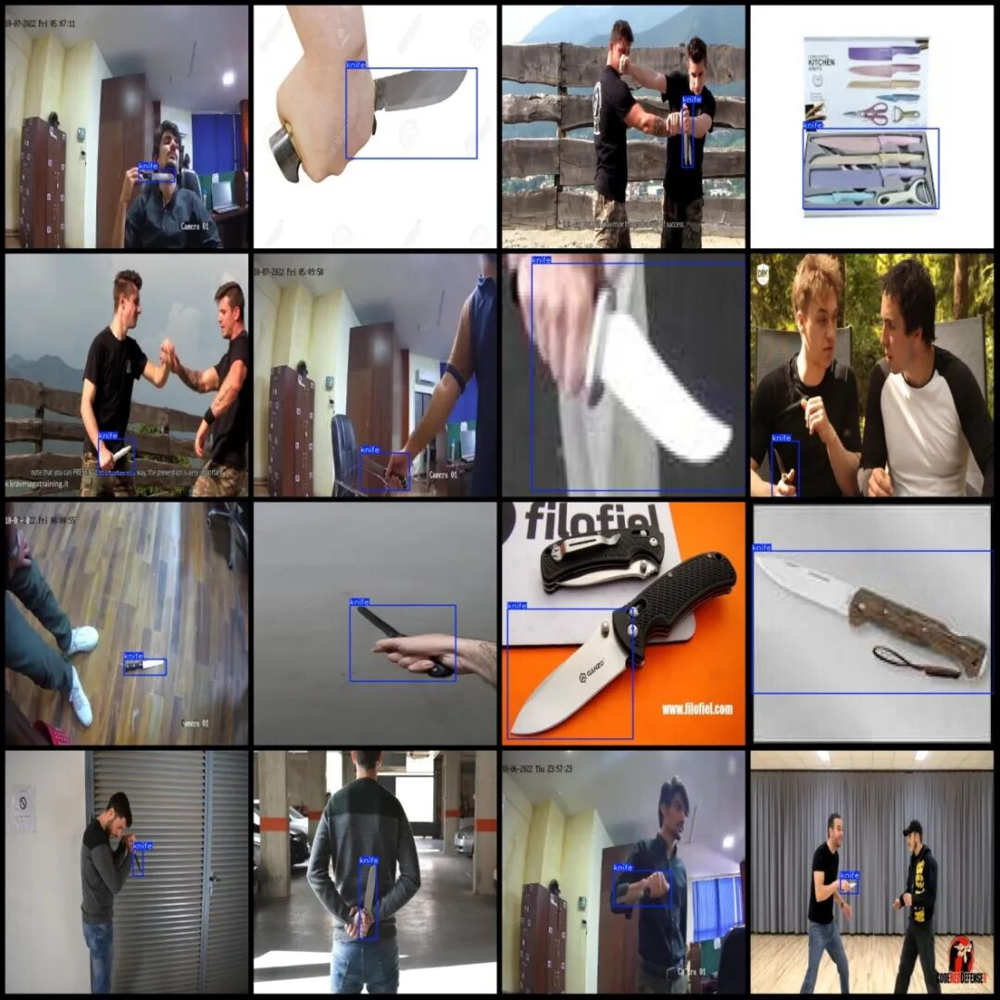

# [C#][Winform] Person with Knife Detection System Based on YOLOv11 C# Source Code + ONNX Model + Evaluation Indicator Curve + High-quality GUI Interface

With the increasingly prominent public safety issues, especially in public places such as airports, stations, schools, etc., the occurrence of dangerous behaviors like carrying knives is frequent, posing a threat to people's life and property safety.

As public safety issues become increasingly prominent, especially in public places such as airports, stations, schools, and others, the occurrence of dangerous behaviors like carrying knives poses a serious threat to people's life and property safety. Traditional surveillance methods often rely on manual observation, but this approach is not only inefficient but also prone to missed or false alarms. Therefore, developing an efficient and accurate knife detection system is particularly important.

A knife detection system based on YOLOv11 has emerged. YOLOv11 is the latest version of the YOLO (You Only Look Once) series, which stands out in the field of object detection with its outstanding accuracy, speed, and efficiency. This system utilizes the advanced algorithms of YOLOv11 to identify and locate knife-wielding behaviors in real-time video.

During the implementation of the system, it is first necessary to collect and label video datasets containing knife-wielding behaviors. These datasets should cover different scenarios, angles, and lighting conditions to ensure the model's generalization capabilities. Subsequently, the YOLOv11 model architecture is utilized for training, with network weights optimized to accurately identify knife-wielding behaviors in videos.

This system boasts several advantages. Firstly, it can achieve efficient real-time monitoring, ensuring quick responses in complex scenarios. Secondly, the algorithm optimization of YOLOv11 enables the system to maintain high accuracy while reducing computational complexity and enhancing operational efficiency. Additionally, the system is highly robust, capable of handling detection tasks under various lighting conditions, angles, and occlusions.

In practical applications, this system can be widely used in public safety monitoring, effectively preventing dangerous behaviors such as carrying knives. At the same time, it can also be combined with other security systems to form a more comprehensive public safety prevention system. In summary, the knife detection system based on YOLOv11 provides new technical means for public safety and is expected to be widely applied and promoted in the future.

[Effect Display]





[Test Environment]

Windows 10 x64 system, VS2019, netFramework4.7.2, OpenCVSharp4.9.0, ONNXRuntime1.22.0

[Training Dataset Introduction]

Dataset format: Pascal VOC format + YOLO format (txt file without split path, only contains jpg images and corresponding VOC format xml files and yolo format txt files)

Number of images (number of jpg files): 12958

Number of annotations (number of xml files): 12958

Number of annotations (number of txt files): 12958

Labeling category count: 1

Label category name (Note that the order of categories in the YOLO format does not correspond to this, but is based on the classes.txt file in the labels folder): ["knife"]

Number of boxes labeled in each category:

Number of knives = 13180

Total frame count: 13180

Using labelImg:

Annotation rules: Draw a rectangle around the category.

Important Notice: No

Special : This dataset does not guarantee the accuracy or precision of the trained models or weight files. The dataset is provided with accurate and reasonable annotations only.

Image Preview:





Annotation example:



[Training Information]


Parameters


Value


Number of training set images


11662


Number of images in the validation set


1296


Training map


96.2%


Training Accuracy


93.9%


Training recall rate


93.9%


[Model can detect 1 class]

knife

[Interface Code]

-
-
-
-
-
-
-
-
-
-
-
-
-
-
-
-
-
-
-
-
-
-
-
-
-
-
-
-
-
-
-
-
-
-
-
-
-
-
-
-
-
-
-
-
-
-
-
-
-
-
-
-
-
-
-
-
-
-
-
-
-
-
-
-
-
-
-
-
-
-
-
-
-
-
-
-
-
-
-
-
-
-
-
-
-
-
-
-
-
-
-
-
-
-
-
-
-
-
-
-
-
-
-
-
-
-
-
-
-
-
-
-
-
-
-
-
-
-
-
-
-
-
-
-
-
-
-
-
-
-
-
-
-
-
-
-
-
-
-
-
-
-
-
-
-
-
-
-
-
-
-
-
-
-
-
-
-
-
-
-
-
-
-
-
-
-
-
-
-
-
-
-
-
-
-
-
-
-
-
-
-
-
-
-
-
-
-
-
-
-
-
-
-
-
-
-
-
-
-
-
-
-
-
-
-
-
-
-
-
-
-
-
-
-
-
-
-
-
-
-
-
-
-
-
-
-
-
-
-
-
-
-
-
-
-
-
-
-
-
-
-
-
-
-
-
-
-
-
-
-
-
-
-
-
-
-
-
-
-
-
-
-

```
using DeploySharp.Data;using OpenCvSharp;using System;using System.Collections.Generic;using System.ComponentModel;using System.Data;using System.Diagnostics;using System.Drawing;using System.IO;using System.Linq;using System.Text;using System.Threading;using System.Threading.Tasks;using System.Windows.Forms;
namespace FIRC{    public partial class Form1 : Form    {
public bool videoStart = false;// Video stop flag
}        public string GetResultString(DetResult[] result)        {            Dictionary<string, int> resultDict = new Dictionary<string, int>();            for (int i = 0; i < result.Length; i++)            {                if(resultDict.ContainsKey( result[i].Category) )                {                    resultDict[result[i].Category]++;                }                else                {                    resultDict[result[i].Category] =1;                }            }
var resultStr = "";            foreach(var item in resultDict)            {                resultStr += string.Format("{0}:{1}\r\n",item.Key,item.Value);            }            return resultStr;        }        private void tsb_pic_Click(object sender, EventArgs e)        {            OpenFileDialog ofd = new OpenFileDialog();            ofd.Filter = "*.*|*.bmp;*.jpg;*.jpeg;*.tiff;*.tiff;*.png";            if (ofd.ShowDialog() != DialogResult.OK) return;            tssl_show.Text = "Detecting......";            Task.Run(() => {                var sw = new Stopwatch();                sw.Start();                Mat image = Cv2.ImRead(ofd.FileName);                detetor.SetParams(Convert.ToSingle(numericUpDown1.Value), Convert.ToSingle(numericUpDown2.Value));                var results=detetor.Inference(image);
var resultImage = detetor.DrawImage(image, results);
sw.Stop(); pb_show.Image = OpenCvSharp.Extensions.BitmapConverter.ToBitmap(resultImage); tb_res.Text = GetResultString(results); tssl_show.Text = "Detection completed!" Total elapsed time is "+sw.Elapsed.TotalSeconds+" seconds"; });
}
public void VideoProcess(string videoPath)        {            Task.Run(() => {
detetor.SetParams(Convert.ToSingle(numericUpDown1.Value), Convert.ToSingle(numericUpDown2.Value));                VideoCapture capture = new VideoCapture(videoPath);                if (!capture.IsOpened())                {                    tssl_show.Text="Video failed to open!";                    return;                }                Mat frame = new Mat();                var sw = new Stopwatch();                int fps = 0;                while (videoStart)                {
capture.Read(frame);                    if (frame.Empty())                    {                        Console.WriteLine("data is empty!");                        break;                    }                    sw.Start();                    var results = detetor.Inference(frame);                    var resultImg = detetor.DrawImage(frame,results);                    sw.Stop();                    fps = Convert.ToInt32(1 / sw.Elapsed.TotalSeconds);                    sw.Reset();                    Cv2.PutText(resultImg, "FPS=" + fps, new OpenCvSharp.Point(30, 30), HersheyFonts.HersheyComplex, 1.0, new Scalar(255, 0, 0), 3);                    // Display results
}
capture.Release();
pb_show.Image = null; tssl_show.Text = "Video has stopped!" "; tsb_video.Text = "Select Video";
});        }        public void CameraProcess(int cameraIndex=0)        {            Task.Run(() => {
detetor.SetParams(Convert.ToSingle(numericUpDown1.Value), Convert.ToSingle(numericUpDown2.Value));                VideoCapture capture = new VideoCapture(cameraIndex);                if (!capture.IsOpened())                {                    tssl_show.Text = "Camera failed to open!";                    return;                }                Mat frame = new Mat();                var sw = new Stopwatch();                int fps = 0;                while (videoStart)                {
capture.Read(frame);                    if (frame.Empty())                    {                        Console.WriteLine("data is empty!");                        break;                    }                    sw.Start();                    var results = detetor.Inference(frame);                    var resultImg = detetor.DrawImage(frame, results);                    sw.Stop();                    fps = Convert.ToInt32(1 / sw.Elapsed.TotalSeconds);                    sw.Reset();                    Cv2.PutText(resultImg, "FPS=" + fps, new OpenCvSharp.Point(30, 30), HersheyFonts.HersheyComplex, 1.0, new Scalar(255, 0, 0), 3);                    // Display results
}
capture.Release();
pb_show.Image = null; tssl_show.Text = "Camera has been stopped!" "; tsb_camera.Text = "Open Camera";
});        }        private void tsb_video_Click(object sender, EventArgs e)        {            if(tsb_video.Text=="Select video")            {                OpenFileDialog ofd = new OpenFileDialog();                ofd.Filter = "Video file(*.*)|*.mp4;*.avi";                if (ofd.ShowDialog() != DialogResult.OK) return;                videoStart = true;                VideoProcess(ofd.FileName);                tsb_video.Text = "Stop";                tssl_show.Text = "Video is being detected....";
}            else            {                videoStart = false;
}        }
private void tsb_camera_Click(object sender, EventArgs e)        {            if (tsb_camera.Text == "Turn on the camera")            {                videoStart = true;                CameraProcess(0);                tsb_camera.Text = "Stop";                tssl_show.Text = "Camera is in detection mode....";
}            else            {                videoStart = false;
}        }
private void tsb_exit_Click(object sender, EventArgs e)        {            videoStart = false;            this.Close();        }
private void trackBar1_Scroll(object sender, EventArgs e)        {            numericUpDown1.Value = Convert.ToDecimal(trackBar1.Value / 100.0f);        }
private void trackBar2_Scroll(object sender, EventArgs e)        {            numericUpDown2.Value = Convert.ToDecimal(trackBar2.Value / 100.0f);        }
private void numericUpDown1_ValueChanged(object sender, EventArgs e)        {            trackBar1.Value = (int)(Convert.ToSingle(numericUpDown1.Value) * 100);        }
private void numericUpDown2_ValueChanged(object sender, EventArgs e)        {            trackBar2.Value = (int)(Convert.ToSingle(numericUpDown2.Value) * 100);        }
private void comboBox1_SelectedIndexChanged(object sender, EventArgs e)        {            tssl_show.Text="Load model:"+comboBox1.Text;            detetor.LoadWeights(weightsPath+"\\"+comboBox1.Text);            tssl_show.Text = "Model loading is complete.!";        }    }}
```

```

```

[Common Evaluation Parameters Introduction]

In the task of object detection, evaluating the performance of a model is crucial. The terms you mentioned are commonly used metrics for assessing the performance of a model. Here are detailed explanations of these terms:

1. **Class**

:

-

This usually refers to the categories of objects that the model is designed to detect. For example, a model may be trained to detect different categories of objects such as vehicles, pedestrians, or animals.

1. **Images**

:

-

Represents the number of images in the validation set. The validation set is a dataset used to evaluate model performance, separate from the training set to ensure fairness in evaluation results.

1. **Instances**

:

-

The total number of target objects in all images. This includes the sum of all category objects, for example, if the validation set contains 100 images, each image has an average of 5 target objects, then Instances is 500.

1. **P (Precision)**

:

-

Precision is the proportion of actual positive samples predicted by the model. The formula is: Precision = TP / (TP + FP), where TP represents true positives (True Positives) and FP represents false positives (False Positives).

1. **R (Recall)**

:

-

Recall is the proportion of all true positives correctly predicted by the model. The formula is: Recall = TP / (TP + FN), where FN represents false negatives.

1. **mAP50**

:

-

Mean Average Precision (mAP) at an IoU threshold of 0.5, where IoU is the metric used to measure the degree of overlap between predicted bounding boxes and ground truth bounding boxes. mAP is a comprehensive metric that considers both precision and recall when evaluating model performance across different recall levels. At an IoU of 0.5, if the overlap between the predicted bounding box and the ground truth bounding box reaches or exceeds 50%, it is considered correct.

1. **mAP50-95**

:

-

This represents the average accuracy of the model across IoU values ranging from 0.5 to 0.95 (with a step of 0.05). This is a more stringent evaluation criterion, demanding higher overlap between predicted bounding boxes and ground truth boxes. In object detection tasks, higher IoU thresholds mean that models need to be more accurate in their target object localization. The computation of mAP50-95 takes into account multiple IoU thresholds ranging from lenient to strict, thus providing a more comprehensive assessment of the model's performance.

These indicators collectively form an important framework for evaluating the performance of target detection models. By comparing the performance of different models on these indicators, It can be determined which model may be more effective in practical applications.

[Usage Steps]

Usage Steps: (1) First, install the YOLOv11 environment according to the official framework ultralytics installation tutorial, and then convert your own pt model into an ONNX model using the official export command. Then, go to the GitHub repository futureflsl/firc-csharp-projects to find the source code. (2) Open the Sln project in Visual Studio 2019, select x64 release, and modify some necessary parameters such as input shape, etc., and then click run to view the final result.

Please note that if there are any runtime errors, refer to my blog for re-invoking the DLL of my source code: [C#] OpenCVSharp error System.Memory, Version=4.0.1.2, Culture=neutral, PublicKeyToken=cc7b13fcd2ddd51 "Version higher than the referenced_ failed to load file or assembly" "system.memory, version=4.0.1.2, culture-CSDN blog

[Provided Files]

C[# Source Code] yolo11n.onnx Model (Provided PyTorch Model)

Training map, P, R curve graph (in weights\results.png)

Test images (under test_img folder)

Please note that here, the training dataset is not provided.


## Payment

Here is a pay link on Stripe ( https://buy.stripe.com/3cs8yP7sY87d0vu9AB ). Please contact me lonlonago@foxmail.com after funding $89, and I will send you a complete data files , thank you!


